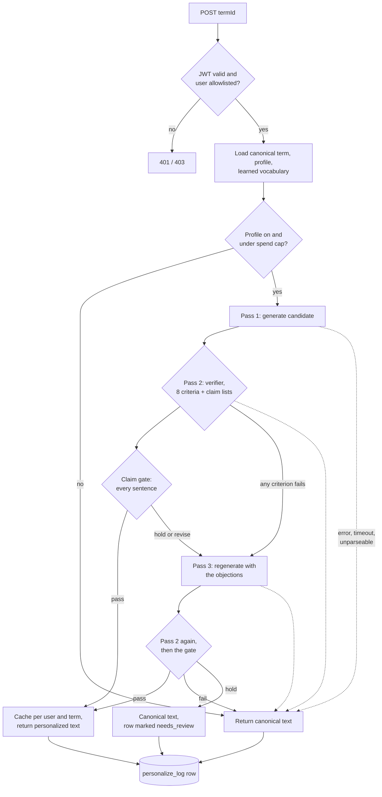

# jargon: speak the room

jargon is a spaced-repetition game that teaches the technical vocabulary people nod along to in meetings and never quite own. Each term is explained in plain English and re-explained through the learner's own background, so "idempotent" lands differently for a nurse, a teacher, and a plumber.

## The problem

Software and AI vocabulary moves faster than anyone can look it up. People in adjacent roles (product, operations, clinical, finance) sit in rooms where "RAG", "webhook", "RLS" and "eval" fly past. They hold back questions, lose the thread, and make weaker decisions. Glossaries are static, generic, and forgotten by the next meeting. Fluency comes from repeated, relevant exposure, which a glossary does not give you.

## What it does

- **Learn and quiz.** Short lessons and quiz cards over 600+ curated terms across coding, AI, and enterprise tooling (Git, APIs, cloud, data, security, LLMs, agents, Microsoft 365 and Power Platform, and more).
- **Spaced repetition.** An SRS and mastery engine schedules reviews, tracks streaks and XP, and shows progress per learning path.
- **Say it in your own words.** Sentence-writing cards are graded on whether you used the term correctly, with feedback instead of a bare right/wrong.
- **Personalized explanations.** A short profile (job, interests, background) drives a rewrite of each term's definition, "why it matters", and example sentence, using analogies from your world.
- **Concept atlas.** A public, source-backed reference map of AI and engineering concepts, with review dates so stale entries are visible.
- **Spotted in the wild.** Paste a meeting transcript and see which known terms appeared.
- **Gift mode.** An invited user can set up a pre-filled profile for someone else and send a magic-link invite.
- **Guided programs.** A multi-module course (currently an eight-module agentic-era track) layered on the same term engine.
- **Feedback loop.** Learners can report a bad analogy or ask a question inside a lesson, and reports are stored for review.

## How the AI parts work

All model calls run server-side in Supabase Edge Functions (`supabase/functions/`). The browser never holds an API key. Every function checks the caller's Supabase JWT and an `allowed_users` table before it spends anything. Monthly per-user and global spend caps are checked against logged costs, priced at list price from one table (`supabase/functions/_shared/pricing.ts`). `personalize-term` also refuses a request whose own worst case could cross a cap. Requests running at the same time are not reserved against each other, so a burst can still overrun a cap. An atomic reservation in Postgres is still open. When a cap is hit or a call fails, the app returns the canonical text instead of an error, and a sentence the grader could not grade is recorded as ungraded, not as a grade.

- **`personalize-term`** writes a personalized version of a term for one user (prompt version 10). Pass 1 generates a candidate with Claude from the canonical entry plus the user's profile, sent as a JSON data block. Pass 2 is a verifier call that grades 8 criteria and lists any claim about the learner's own field it cannot support, and any canonical statement it doubts. The accept decision is computed in code from the criteria, not taken from the model's own summary. A deterministic claim gate then reads every sentence and fails closed. A sentence about the learner's field is held unless the verifier quotes it as supported. An analogy into the field, or a restriction about it (only, only if, never, restricted to, unless, locked out and similar) that no canonical sentence states, is held even when the verifier vouches for it. A claim the verifier marked unsupported is held. A held or failed rewrite gets one regeneration with the objections, and otherwise the learner sees the canonical text and the log row is marked `needs_review`. Accepted results are cached per user and term. A stale or reported rendering is never shown. See `docs/verification.md`.
- **`grade-sentence`** grades a learner's sentence as pass, partial, or fail with feedback. A timeout, an error, the spend cap, an unreadable reply or a tier that disagrees with its score returns `ungraded`, which writes no progress and earns no XP.
- **`ingest-terms`** is a weekly cron-triggered pipeline that proposes new terms. Claude Sonnet drafts candidates weighted toward under-covered paths. Claude Opus verifies accuracy, then relevance to the domain goals. Claude Haiku independently rewrites the one-line definition with no context, and an OpenAI embedding similarity screen (cosine at or above 0.85, one-line definitions only) compares the two. Every gate fails closed, each cycle has its own budget, and learners do not see a generated term until a person reviews it.
- **`generate-term-etymology`** writes the "why it's called that" note with the same generate, verify, retry-once pattern.
- **`compose-gift-profile`** turns a free-text description of a person into a draft profile with a self-check pass. The sender reviews and edits everything.
- **`generate-job-followup`** asks one clarifying question with a few chip options after a user types their job.
- **`answer-lesson-question`** answers questions asked during a lesson.
- **`pick-lived-icons`** and **`generate-lived-icon-image`** choose motifs from a profile and generate a badge image (Claude for motifs, Gemini for the image), capped per user per day.
- **`report-analogy-issue`** stores a learner's complaint about an analogy, with the reported text, and deletes the cached rendering so it is never shown again.

Two design rules recur: bounded retries (at most one regeneration, each call wrapped in an `AbortController` timeout), and degrade-to-canonical on any failure. For `personalize-term` the prompts are in `prompts.ts` and the pass sequence is in `pipeline.ts`. The Edge Function and the offline eval both run that pipeline, so the eval measures the same pass sequence, verifier parsing and gate. It does not run the cache, the backoff, the spend check or the SDK transport.

The `personalize-term` pipeline:



## Evaluation

**Honest headline.** One development run on 2026-10-30 covered 79 of 120 planned items: 27 of 40 terms, no hard term, and 3 profiles written by the author, all with an empty learned vocabulary. The same model family generated and verified, and the verifier accepted 78 of 79. Of the 4 errors the rewrites introduced, the verifier caught **0 of 4** (95% CI 0-49%), and all 4 sat in outputs that used an analogy. Counting errors copied from wrong canonical entries, at least **9 of 78** accepted outputs (12%, 95% CI 6-20%) showed a learner a claim judged wrong. Only 5 of those 9 were confirmed by a person, after an AI screen flagged them, and 73 of the 78 accepted outputs never had an expert read. There was no baseline. There is no measured learning benefit.

The published figure "5 of 78 wrong (6.4%)" counted the 5 expert-confirmed outputs only. One of those 5 copied its error from the canonical text, and 4 more inherited errors were left out. The run cost **$2.92** at list price, about $0.037 per item. It logged $8.77 because the pricing constants were three times list price, and the budget guard stopped the run at 79 items on that inflated figure. All 120 items would have cost about $4.44.

| Set | Status | Used for |
| --- | --- | --- |
| `eval/results/2026-10-30.jsonl` (79 items) | Development data | The numbers above. The claim gate, the labels and the dev cases were all written after reading it. |
| `eval/data/dev-cases-v1.json` (25 cases) | Development data | Gate tests: each of the four failure kinds, a reworded version of each, false-hold guards and two documented gaps. |
| A blind, locked test set | Not built yet | The only set a headline can come from. `docs/evaluation.md` says what it needs. |

**What changed since that run.** The claim gate was built from those 4 introduced errors and then rebuilt after an outside review (round 2) showed that small rewordings passed it. It now holds any sentence about the learner's field the verifier does not quote as supported. Replayed over the saved outputs, it holds all 4 introduced errors either way, which is expected from a gate built from them. The 2026-10-30 verifier listed no claims, so the replay shows two bounds. With nothing vouched for, the gate holds 76 of 78 accepted outputs, including all 9 that the AI read-through judged correct. With every sentence vouched for, it holds 25 of 78, including 3 of those 9. A held rewrite shows the learner the canonical text, so the cost of a false hold is lost personalization. These are development results. The three wrong canonical entries are corrected (`docs/canonical-review.md`), and that correction still needs a person's review. How the new pipeline does on outputs it has never seen is unmeasured.

The full corrected report, generated from the saved rows, is `eval/results/2026-10-30-report.md`. The published summary, `eval/results/2026-10-30-summary.md`, stays as it was written, with its inflated costs, and `eval/frozen-artifacts.json` pins it and the run's inputs.

**What a fair evaluation needs** (details in `docs/evaluation.md`):

- A blind test set written by people or models that did not see this run, locked by hash before any scoring, and scored once.
- A baseline: the canonical text alone, and a plain rewrite with no personalization, judged the same way.
- A verifier from a different model family than the generator, compared against the current one.
- Expert review of a random sample of accepted outputs, not only the ones an AI screen flagged, done blind to the verifier's verdict.
- Hard terms, more profiles than the author's three, and learners with real learned vocabulary.

Reproduce the offline parts (no model calls):

```sh
node eval/replay-gate.ts          # claim gate over the saved outputs
node eval/report.ts               # corrected report
node eval/check-rendering.ts --term bi-rls --profile nurse --rendering my-rewrite.json --analogy
node scripts/audit-canonical.mjs  # canonical entries a person should read first
```

A new run makes paid model calls and needs an explicit budget. See `eval/README.md`.

## Data handling

- **Sent to Anthropic:** the learner profile (job, education, interests, background, goals and where they meet the vocabulary), the term, sentences written for grading, questions asked in a lesson, and gift descriptions of another person. **Sent to OpenAI:** the one-line definitions of generated terms (ingest only). **Sent to Gemini:** badge image prompts built from profile motifs.
- **Stored in Supabase:** profiles, progress and cached renderings, `personalize_log` (every candidate, verdict and gate result, so text derived from the profile is in it), `analogy_reports` (the reported text and the complaint) and `compose_gift_log` (the recipient's name). The grade and lesson-question logs keep the term, score and status, not the learner's text.
- No retention period is set for these tables, and this repository documents no data terms with the model providers.
- Nothing in the app detects or removes patient, customer or other personal details. Learners should not type them into sentences, questions or profiles.

## What real-world use would need

- The blind evaluation in `docs/evaluation.md`, with a baseline and expert review of accepted outputs.
- A person working the `needs_review` queue and the canonical audit, with each decision recorded.
- A retention policy and provider data terms for the tables above.
- A boundary for lesson questions asked in clinical settings. The question function answers any question about a term and has no rule against clinical advice.
- Monthly cost at real usage. Personalizing the whole 646-term corpus once costs roughly $24 per learner at the 2026-10-30 list-price rate of about $0.037 per item, more than the default $5 per-user monthly cap, so a full corpus would personalize over several months.

## Stack

- React 18, TypeScript, Vite, React Router, Zustand, Tailwind CSS
- Supabase: Postgres with row-level security, Auth (magic link, optional Google), Edge Functions (Deno), Storage
- Anthropic Claude (Opus, Sonnet, Haiku), OpenAI embeddings, Gemini image generation
- Vitest and Testing Library for unit and component tests, SQL tests against the real migrations on PostgreSQL 17, Playwright for end-to-end
- Vercel hosting and a weekly cron route (`api/cron/ingest-terms.ts`)
- PWA manifest and service worker, with optional Sentry

## Run it locally

Requirements: Node 24, which CI uses (the eval and audit scripts run `.ts` files directly, which needs Node 23.6 or later), and the Supabase CLI plus Docker if you want a local backend. The SQL tests need PostgreSQL 17 (`PG_BIN` points at its `bin` directory).

```sh
npm install
cp .env.example .env.local      # then fill in values
npm run dev                     # prints a local address, which the dev CORS origins allow
npm test                        # unit and component tests
npm run build                   # type-check and production build
npm run typecheck:functions     # strict type check of the Edge Functions
npm run test:sql                # SQL tests against the real migrations
npm run lint                    # both type checks (no ESLint is configured)
```

CI (`.github/workflows/ci.yml`) runs all of these on every pull request. No step calls a model or needs a secret.

Local backend:

```sh
npx supabase start              # prints the local URL and anon key for .env.local
npx supabase db reset           # applies supabase/migrations and supabase/seed.sql
```

To exercise the AI features, set `ANTHROPIC_API_KEY` (and optionally `OPENAI_API_KEY`, `GEMINI_API_KEY`) as Edge Function secrets, then serve the functions with `npx supabase functions serve`. Every variable is documented in `.env.example`. No secrets are committed.

`supabase/schema-history/` holds the numbered SQL files this project was originally applied with. `supabase/migrations/` and `supabase/seed.sql` are the current source for a fresh local database.

## Content

The term corpus is generic. It covers public software, AI, and enterprise-tooling vocabulary, written for a general working audience. It contains no proprietary material. Example sentences use made-up people and scenarios.

## Project notes

- Sign-in is invite-only by design (an allowlist plus magic-link auth), so a public deployment shows the landing page and the concept atlas to visitors without an invite.
- Some comments reference earlier internal stage names (for example "Stage B+1"). They are release labels from the project's history.

## Development history

Built May to October 2026 over 296 commits in a private repository. The full history includes personal notes and private configuration, so this repository is a cleaned public snapshot. The evaluation and the changes described above were added for this release in October and November 2026.

## Author

Built by Kevin Madden as a side project. MIT licensed, see `LICENSE`.
