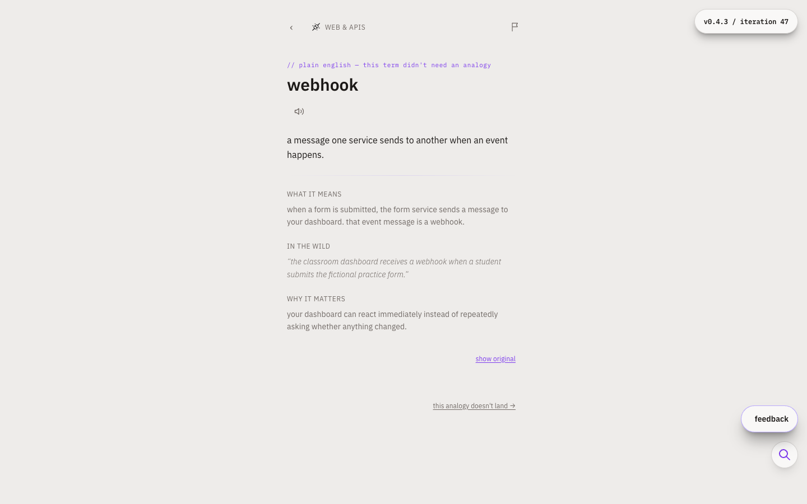
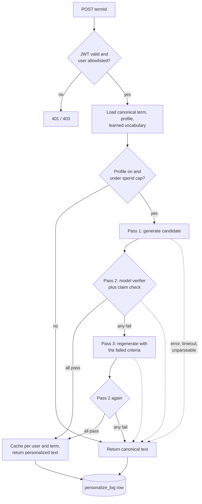

# jargon: speak the room

jargon is a spaced-repetition game that teaches the technical vocabulary people nod along to in meetings and never quite own. Each term is explained in plain English and re-explained through the learner's own background, so "idempotent" lands differently for a nurse, a teacher, and a plumber.

## The problem

Software and AI vocabulary moves faster than anyone can look it up. People in adjacent roles (product, operations, clinical, finance) sit in rooms where "RAG", "webhook", "RLS" and "eval" fly past. They hold back questions, lose the thread, and make weaker decisions. Glossaries are static, generic, and forgotten by the next meeting. Fluency comes from repeated, relevant exposure, which a glossary does not give you.

## What it does

- **Learn and quiz.** Short lessons and quiz cards over 600+ curated terms across coding, AI, and enterprise tooling (Git, APIs, cloud, data, security, LLMs, agents, Microsoft 365 and Power Platform, and more).
- **Spaced repetition.** An SRS and mastery engine schedules reviews, tracks streaks and XP, and shows progress per learning path.
- **Say it in your own words.** Sentence-writing cards are graded on whether you used the term correctly, with feedback instead of a bare right/wrong.
- **Personalized explanations.** A short profile (job, interests, background) drives a rewrite of each term's definition, "why it matters", and example sentence, using analogies from your world.
- **Concept atlas.** A public, source-backed reference map of AI and engineering concepts, with review dates so stale entries are visible.
- **Spotted in the wild.** Paste a meeting transcript and see which known terms appeared.
- **Gift mode.** An invited user can set up a pre-filled profile for someone else and send a magic-link invite.
- **Guided programs.** A multi-module course (currently an eight-module agentic-era track) layered on the same term engine.
- **Feedback loop.** Learners can report a bad analogy or ask a question inside a lesson; reports are stored for review.



Synthetic fixture, with capture-only light tokens. The app currently ships a dark palette. [Capture method and mobile views](docs/media/README.md).

## Verifier follow-up

The original verifier accepted five explanations that Kevin Madden, PharmD, confirmed were wrong. A new deterministic check holds unsupported clinical access and credential claims and a staging contradiction for rewriting. Replaying the 78 saved acceptances holds all five known errors and seven additional outputs that still need expert review.

On a new frozen 24-item synthetic challenge, the added rule misses four of twelve incorrect examples and rejects four of twelve correct ones. That comparison tests the rule alone. No fresh LLM before/after run was performed because this job prohibits paid API calls. The historical result is unchanged, and these numbers are not an overall accuracy claim.

Read the [method, all misses, false rejections and clinical-summary implications](docs/evaluation/verifier-upgrade.md). The implementation is pending model evaluation and expert review before release.

## Evaluation

The function's `personalize_log` table has too few rows to measure anything, so the verifier was tested offline.

**Method (run 2026-10-30).** `eval/run-personalize-eval.ts` calls the Anthropic API directly. It imports the prompts, model ID, token limits, JSON parsers and cost formula from `supabase/functions/personalize-term/prompts.ts`, the same module the Edge Function uses. The pass sequence and the HTTP request shape are copied from the handler, and the file header lists what is copied. A parity check against the pre-refactor file confirmed that all 747 prompt strings, builder outputs, parser results and constants tested were byte-identical. The inputs are 40 terms from `supabase/seed.sql` (8 each from AI/LLM, data, security, APIs and cloud paths, picked deterministically by `eval/build-dataset.mjs`) crossed with 3 synthetic learner profiles: a hospital nurse, a retail pharmacist and a high-school teacher (`eval/data/`). Every profile has an empty learned-vocabulary list (a new user). Every pass used `claude-opus-4-7` at default temperature, with concurrency 3. A $10 budget guard stopped the run after **79 of the 120 planned items**. Runs were interleaved by category and profile, so each category has 15 to 18 runs and each profile 26 or 27.

| outcome (n = 79) | count | rate |
|---|---|---|
| accepted first try | 76 | 96.2% |
| accepted after one retry | 2 | 2.5% |
| fell back to canonical | 1 | 1.3% |
| pass-1 verifier verdict = pass | 76 of 79 | 96.2% |
| retry verdict = pass | 2 of 2 | |
| accepted outputs that used an analogy | 18 of 78 | 23% |

The single fallback was a Pass 1 JSON parse failure, not a verifier rejection. Across 78 parsed first-pass verdicts, `technical_accuracy_preserved` and `analogy_target_accurate` never failed. The two rejections were for an inaccurate SBAR analogy, which was a correct catch, and for a capitalized example sentence.

| cost and latency | value |
|---|---|
| total spend, 79 runs | $8.77 (function formula: $8.20) |
| mean cost per item | $0.111 (accepted first try $0.109, after retry $0.225) |
| latency p50 / p95 / max | 10.9 s / 16.9 s / 24.1 s |

Costs use the pricing constants in the function ($15 / $75 per million input / output tokens). These were not checked against current list prices, so the dollar figures may run high. The function's cost formula ignores prompt-cache tokens. The verifier's 3,731-token system prompt is cached, so `personalize_log.total_cost_usd`, which the spend guard reads, came out about 7% below the cache-inclusive figure in this run. Latency is the sum of the model calls in a run and leaves out Supabase round trips.

**Verifier misses: 5 of 78 accepted outputs (6.4%).** All 79 outputs were read after the run by an AI model (Claude), which flagged five accepted outputs as wrong or probably wrong. Kevin Madden, PharmD, then reviewed those five and confirmed all five are wrong. The other accepted outputs were read by the AI model only, so 6.4% is a floor, not a full domain-expert audit. The five:

- An RLS analogy told the nurse that hospital systems only let nurses open charts on their own unit. Typical EHRs allow wider access and police it through audits. The verifier's reasoning stated the wrong claim as fact.
- An example sentence said staging was the only environment connected to the real insurance-claims system. That is backwards, and it contradicts the output's own definition of production.
- A pharmacist RLS analogy said a tech only sees patient profiles tied to their store. Chain profiles are shared across stores so transfers and refills work.
- A JWT analogy described a "signed, tamper-evident script label". No such label exists; tamper-resistance rules cover prescription pads, not dispensing labels.
- An OAuth analogy built on "the patient's login to their chart" at a pharmacy, which patients do not have.

The verifier's accuracy checks failed 0 times across these runs, so it behaves close to a rubber stamp when the same model family writes and checks. Four of the five misses sit in the 18 outputs that used an analogy. Two further errors come from the seed text itself: totals from a calculated column "won't move when you slice", and Claude's parameter count is stated as known. The verifier checks against the canonical entry, so it cannot catch errors there. The full sample, with verbatim text and per-item notes, is in `eval/results/2026-10-30-summary.md`.

**Limits.** n = 79 from one run of a non-deterministic model, with no repeats. The term set and the profiles were written by the author. The verifier is an LLM, the same model as the generator, and the post-hoc review is also an LLM. Cold-start vocabulary only. The run did not touch Supabase, auth, caching or the spend guard. Read the rates above as "the verifier rarely rejects", not as a measured accuracy figure.

Reproduce:

```sh
node eval/build-dataset.mjs                      # rebuilds eval/data/terms.json from the seed
export ANTHROPIC_API_KEY=...                     # read from your secret store; never written to disk
EVAL_DATE=2026-10-30 node eval/run-personalize-eval.ts   # Node 23.6+; resumes from an existing results file
node eval/summarize.mjs 2026-10-30               # writes eval/results/2026-10-30-summary.md
```

## How the AI parts work

All model calls run server-side in Supabase Edge Functions (`supabase/functions/`). The browser never holds an API key. Every function checks the caller's Supabase JWT and an `allowed_users` table before it spends anything. Monthly per-user and global spend ceilings are enforced from logged costs, and when a cap is hit or a call fails, the app returns a canonical (non-personalized) answer instead of an error.

- **`personalize-term`** writes a personalized version of a term for one user. Pass 1 generates a candidate with Claude from the canonical entry plus the user's profile. Pass 2 is a separate verifier call that checks the candidate against pass/fail criteria, including that the technical fact is preserved and that any analogy is accurate on both sides. A deterministic claim check can also reject a candidate regardless of the model verdict. On failure it regenerates once with the verifier's objection, re-verifies, and otherwise falls back to the canonical text. Passing results are cached per user and term.
- **`grade-sentence`** grades a learner's sentence as pass, partial, or fail with feedback. It has a defined fallback if the model call fails.
- **`ingest-terms`** is a weekly cron-triggered pipeline that proposes new terms. Claude Sonnet drafts candidates weighted toward under-covered paths. Claude Opus verifies accuracy, then relevance to the domain goals. Claude Haiku independently rewrites the one-line definition with no context, and an OpenAI embedding comparison (cosine similarity at or above 0.85) confirms it agrees with the drafted definition before a term is accepted.
- **`generate-term-etymology`** writes the "why it's called that" note with the same generate, verify, retry-once pattern.
- **`compose-gift-profile`** turns a free-text description of a person into a draft profile with a self-check pass. The sender reviews and edits everything.
- **`generate-job-followup`** asks one clarifying question with a few chip options after a user types their job.
- **`answer-lesson-question`** answers questions asked during a lesson.
- **`pick-lived-icons`** and **`generate-lived-icon-image`** choose motifs from a profile and generate a badge image (Claude for motifs, Gemini for the image), capped per user per day.
- **`report-analogy-issue`** stores a learner's complaint about an analogy and clears the cached rendering.

Two design rules recur: bounded retries (at most one regeneration, each call wrapped in an `AbortController` timeout), and degrade-to-canonical on any failure. Prompts and pricing constants live in the function files, so the behavior is auditable in one place. For `personalize-term` they are in `supabase/functions/personalize-term/prompts.ts`, which the offline eval imports directly.

The `personalize-term` pipeline:



## Evaluation review screen

After `npm install`, launch the offline review with one command:

```sh
npm run dev:evaluation
```

Open <http://localhost:5182/evaluation.html>. No environment file, sign-in,
backend or model key is needed. The page reads the committed 79-run JSONL,
expert-confirmation IDs and source review notes. It runs the actual supplemental
`checkCandidateClaims` library on the saved synthetic learner outputs.

Search by term or learner, filter historical agreements and disagreements, and
open any row for the full rewrite and review. The five expert-confirmed misses
appear first. Every other output says **Not reviewed**, including those with AI
review notes. The agreement filter has an explicit empty state because no expert
correctness labels are recorded for successful outputs.

**Replay current policy** compares historical verdicts with deterministic holds
from the upgrade branch. This does not run an LLM or regenerate a rewrite. It
holds all five confirmed misses and seven additional unadjudicated acceptances.
The upgrade is a dependency pending independent review, not a landed model
accuracy improvement. The light and dark themes use the imported design tokens.
`npm run build` includes the standalone page in the static output.

Portfolio captures and the core-flow GIF are in [docs/media](docs/media).
[Verification evidence](docs/evaluation/showcase-verification.md) records tests,
control failures and capture reproduction.

## Stack

- React 18, TypeScript, Vite, React Router, Zustand, Tailwind CSS
- Supabase: Postgres with row-level security, Auth (magic link, optional Google), Edge Functions (Deno), Storage
- Anthropic Claude (Opus, Sonnet, Haiku), OpenAI embeddings, Gemini image generation
- Vitest and Testing Library for unit tests (1,100+), Playwright for end-to-end
- Vercel hosting and a weekly cron route (`api/cron/ingest-terms.ts`)
- PWA manifest and service worker; Sentry is optional

## Run it locally

Requirements: Node 20+, and the Supabase CLI plus Docker if you want a local backend.

```sh
npm install
cp .env.example .env.local      # then fill in values
npm run dev                     # http://localhost:5182
npm test                        # unit tests
npm run build                   # type-check and production build
```

Local backend:

```sh
npx supabase start              # prints the local URL and anon key for .env.local
npx supabase db reset           # applies supabase/migrations and supabase/seed.sql
```

To exercise the AI features, set `ANTHROPIC_API_KEY` (and optionally `OPENAI_API_KEY`, `GEMINI_API_KEY`) as Edge Function secrets, then serve the functions with `npx supabase functions serve`. Every variable is documented in `.env.example`. No secrets are committed.

`supabase/schema-history/` holds the numbered SQL files this project was originally applied with. `supabase/migrations/` and `supabase/seed.sql` are the current source for a fresh local database.

## Content

The term corpus is generic. It covers public software, AI, and enterprise-tooling vocabulary, written for a general working audience. It contains no proprietary material. Example sentences use made-up people and scenarios.

## Project notes

- Sign-in is invite-only by design (an allowlist plus magic-link auth), so a public deployment shows the landing page and the concept atlas to visitors without an invite.
- Some comments reference earlier internal stage names (for example "Stage B+1"). They are release labels from the project's history.

## Development history

Built May to October 2026 over 296 commits in a private repository. The full history includes personal notes and private configuration, so this repository is a cleaned public snapshot. The evaluation and the changes described above were added for this release in October 2026.

## Author

Built by Kevin Madden as a side project. MIT licensed; see `LICENSE`.
